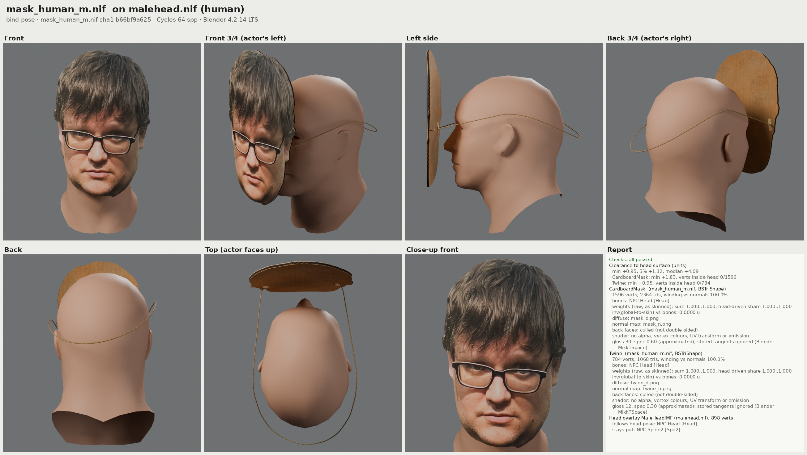
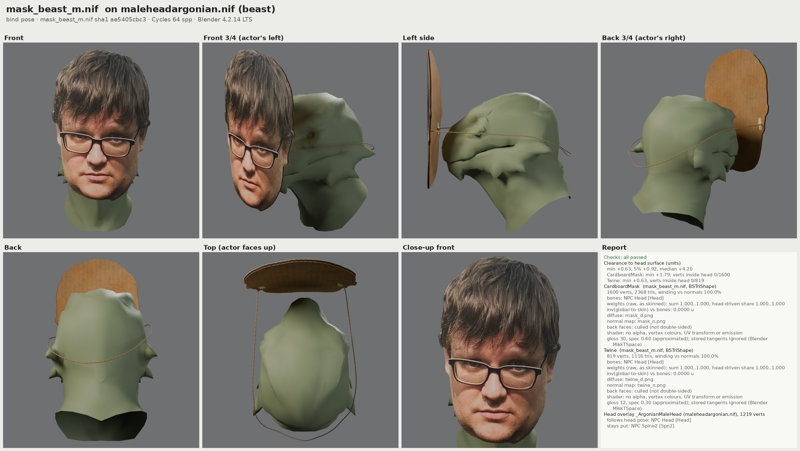
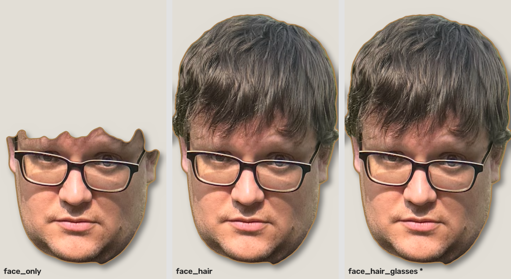

# Cardboard Face Mask (Skyrim Special Edition)

Every adult humanoid NPC in Skyrim wears a cardboard cut-out of my face (once SPID and KEF are
installed, see [Requirements](#requirements)): a thin slab cut along
the outline of the head in `input/IMG_2117.PNG`, the photo printed on the front, corrugated
cardboard edges, a brown kraft back with masking-tape strips, and a twine string that wraps
awkwardly around the back of the head. Personal-use joke mod; no scripts.



*Offline preview rendered with Blender from a NIF built by this pipeline, on Skyrim's vanilla male
head (`src/render_check.py`; the image header names the NIF's sha1, so you can tell whether it
matches the NIF in `dist/`). This is not an in-game screenshot.*

| Khajiit/Argonian variant | Cut-out modes (`silhouette_mode`) |
|---|---|
|  |  |

More previews: `docs/renders/textures_atlas.png` (the texture atlas), `fit_mask_*.png` (fit on each
head), `render_vanilla_helmet.png` (a vanilla helmet rendered the same way, as a reference).

> **Status.** The package is built and checked offline (meshes, textures, plugin, SPID lines,
> zip; see "How it is checked" below). It has **not yet been tried in the game**: there is no
> Skyrim install where it was built. Run the checklist in [docs/TESTING.md](docs/TESTING.md) the
> first time you install it.

## How it works

* `CardboardFaceMask.esp` (ESL-flagged, master `Skyrim.esm` only) adds one clothing item,
  "Cardboard Face Mask" (`FaceMaskArmor`, local FormID 0x800, weight 0, value 0, armor 0) that uses
  biped slot 55, so it can be worn together with helmets and hoods. Two armatures pick the human or
  the Khajiit/Argonian mesh, male and female.
* [Spell Perk Item Distributor](https://www.nexusmods.com/skyrimspecialedition/mods/36869) (SPID)
  reads `CardboardFaceMask_DISTR.ini` and puts one mask into the inventory of every NPC that has the
  `ActorTypeNPC` keyword and is not a child:
  `Item = 0x800~CardboardFaceMask.esp|ActorTypeNPC|NONE|NONE|-C|1|100`.
  **SPID does not make anyone wear it**: it only adds items to inventories (its item-equipping code
  was removed in 2024), and users report that NPCs leave such armor in the inventory unworn.
* So the same ini also gives the same NPCs a keyword:
  `Keyword = KEFEquip_0x800_CardboardFaceMask_esp|ActorTypeNPC|NONE|NONE|-C|NONE|100`.
  SPID creates the keyword itself (no plugin defines it). On its own it does nothing;
  [KEF - Keyword Equip Framework](https://www.nexusmods.com/skyrimspecialedition/mods/185273), a
  small SKSE plugin you install separately, reads `KEFEquip_0x800_CardboardFaceMask_esp` and makes
  the NPC equip item `0x800` of `CardboardFaceMask.esp`, i.e. the mask, in slot 55. KEF's page
  indicates that KEF adds the item itself, so with KEF an NPC will probably carry **two** masks,
  one of them worn (harmless; the `Item` line is kept in case KEF only equips). Without KEF, NPCs
  are expected to just carry the mask (users report this for SPID items; docs/TESTING.md 3b.1
  checks it). None of this has been tried in game yet; how SPID handles both lines is checked
  against SPID's source, KEF only against its Nexus page ([docs/SPID_NOTES.md](docs/SPID_NOTES.md)
  sections 9 and 13, which list what is verified).
* `equip_method: engine` in `config.yaml` drops the keyword line (for players who do not want KEF;
  then NPCs probably only carry the mask).
* The player never gets one automatically (SPID skips the player); try it on with the console.
* The meshes are rigidly skinned to the head bone (`NPC Head [Head]`), so the mask follows the head.

## Requirements

| What | Version | Notes |
|---|---|---|
| Skyrim Special Edition (Steam) | runtime 1.7.104 | the version these notes were written for |
| [SKSE64](https://skse.silverlock.org/) | 2.3.1 (the "Anniversary Edition" build for 1.7.104) | download link on skse.silverlock.org points to [Nexus](https://www.nexusmods.com/skyrimspecialedition/mods/30379?tab=files); start the game with `skse64_loader.exe` |
| [Address Library for SKSE Plugins](https://www.nexusmods.com/skyrimspecialedition/mods/32444) | the release for 1.7.104 (you use v13) | SKSE needs `Data\SKSE\Plugins\versionlib-1-7-104-0.bin` |
| [Spell Perk Item Distributor](https://www.nexusmods.com/skyrimspecialedition/mods/36869) | 7.3.3 is the newest source release | SE/AE build (not the VR one) |
| [KEF - Keyword Equip Framework](https://www.nexusmods.com/skyrimspecialedition/mods/185273) | the newest file | makes NPCs **wear** the mask; without it they are expected to only carry it. Needs SKSE and Address Library. Not needed with `equip_method: engine` |

powerofthree's Tweaks is **not** needed (the ini uses a FormID, not an EditorID). Why SPID 7.3.3
loads on 1.7.104, with source citations: [docs/SPID_NOTES.md](docs/SPID_NOTES.md) section 11.

**What is known about KEF.** Its source code could not be found and its Nexus page could not be
opened from the build machine, so everything about KEF comes from search-engine extracts of that
page: the keyword format `KEFEquip_0x[FORMID]_[MODNAME]_[EXTENSION]`, the example
`KEFEquip_0x800_MyCoolAmulet_esp` (the same shape as ours: ID `0x800` in an `.esp`), "compatible
with all Skyrim versions (SE, AE, VR)", and a last update of its CommonLibSSE-NG "for new skyrim
update". The same page says that if the NPC already wears another item in that slot, "the item
is NOT added to the NPC's inventory and is not equipped", unless the keyword ends in
`_forceEquip_true` (then KEF unequips the other item); its second example names a plugin with an
`_` (`Kad_AkaviriHats.esp`). That wording implies KEF normally adds the item itself. **Not
verified:** that the current KEF file loads on 1.7.104 (check `skse64.log`), and that KEF adds the
item. The ini therefore keeps both lines, and with KEF an NPC will probably carry a second mask,
which is harmless. Details: [docs/SPID_NOTES.md](docs/SPID_NOTES.md) section 13.

## Install

The build output is `dist/CardboardFaceMask.zip` (zip root = contents of the `Data` folder) and the
same files unpacked in `dist/CardboardFaceMask/`:

```
CardboardFaceMask.esp
CardboardFaceMask_DISTR.ini
meshes/CardboardFaceMask/mask_human_m.nif, mask_human_f.nif, mask_beast_m.nif, mask_beast_f.nif
textures/CardboardFaceMask/mask_d.dds, mask_n.dds, twine_d.dds, twine_n.dds
```

Install SKSE, Address Library, SPID and KEF first (each from its Nexus page; with MO2 or Vortex
like any other mod), then one of:

* **Mod Organizer 2**: *Install a new mod from an archive* -> pick `CardboardFaceMask.zip` -> OK.
  Tick the mod in the left pane and make sure `CardboardFaceMask.esp` is ticked in the right pane
  (*Plugins*). Launch *SKSE* from MO2.
* **Vortex**: drag `CardboardFaceMask.zip` onto the *Mods* page (or *Install From File*), enable it,
  let Vortex deploy, and check that `CardboardFaceMask.esp` is enabled on the *Plugins* page.
* **Manual**: copy everything inside `dist/CardboardFaceMask/` (or the zip's contents) into the game's
  `Data` folder, keeping the `meshes/` and `textures/` sub-folders. The `_DISTR.ini` must sit directly
  in `Data`, not in a sub-folder. Then activate the plugin: add the line `*CardboardFaceMask.esp`
  to `Plugins.txt` (Windows: `%LOCALAPPDATA%\Skyrim Special Edition\Plugins.txt`; in a CrossOver
  bottle the same file is under `drive_c/users/<user>/AppData/Local/Skyrim Special Edition/`), or use
  a mod manager.
  * Windows PC (default Steam library):
    `C:\Program Files (x86)\Steam\steamapps\common\Skyrim Special Edition\Data`
  * Mac with CrossOver:
    `~/Library/Application Support/CrossOver/Bottles/<Bottle>/drive_c/Program Files (x86)/Steam/steamapps/common/Skyrim Special Edition/Data`
    (in Finder: *Go -> Go to Folder...*, paste the path with your bottle name).

The plugin is ESL-flagged, so it does not use one of the 254 regular plugin slots.

## Configuration

Edit `config.yaml` and rebuild. Most options only need `.venv/bin/python src/build_all.py --skip-ml`,
which reuses the cut-out outline from the last segmentation run. **`silhouette_mode` and
`source_image` change the outline itself and need the segment stage**: run
`.venv/bin/python src/build_all.py` without `--skip-ml` (`build_all.py` stops with an error if the
outline does not match `config.yaml`, and so does the package stage). Options:

| Key | Default | Effect |
|---|---|---|
| `source_image` | `input/IMG_2117.PNG` | the photo the mask is cut from (needs the segment stage) |
| `silhouette_mode` | `face_hair_glasses` | outline of the cut-out: `face_only`, `face_hair`, `face_hair_glasses` (picture above) |
| `thickness_units` | 0.3 | cardboard thickness (1 unit = 1.43 cm) |
| `forward_offset_units` | 1.8 | gap between the nose tip and the back of the mask |
| `bend_radius_units` | 24 | how much the sheet curves around the face; 0 = flat |
| `size_factor` | 1.08 | photo chin-to-crown height relative to the NPC's |
| `scale_human`, `scale_female`, `scale_beast` | 1.0, 0.96, 1.25 | per-mesh scale (female is applied on top of human) |
| `edge_wobble_units` | 0.04 | hand-cut jitter of the outline; 0 = clean die-cut |
| `string_radius_units`, `string_sag`, `string_asymmetry` | 0.06, 0.6, 0.35 | twine thickness, droop at the back, lopsidedness |
| `string_clearance_units` | 1.0 | how far the twine rides above the bald scalp at the back of the head, i.e. over typical hair (0.15 = tight to the skull, hidden under hair) |
| `tape_strip` | true | masking-tape strips on the back |
| `texture_size`, `twine_texture_size` | 2048, 512 | texture resolution (powers of two) |
| `plugin_name` | `CardboardFaceMask.esp` | plugin file name (the ini follows it) |
| `slot` | 55 | biped slot |
| `non_playable` | false | true hides the mask from inventories and loot; test that NPCs still wear it before relying on it |
| `exclude_children` | true | adds the SPID trait `-C` |
| `chance_percent` | 100 | share of matching NPCs that get a mask (0 < chance <= 100). Below 100 the ini gets SPID's `!` suffix (e.g. `25!`), so the same NPCs keep their masks every time you load that character; without `!` SPID re-rolls on every game launch |
| `distribute_to_player` | false | has no effect: SPID never gives items to the player |
| `equip_method` | `kef` | `kef`: the ini has the `Item` line plus the `KEFEquip_...` `Keyword` line, so NPCs wear the mask when KEF is installed. `engine`: `Item` line only; SPID never equips items, so NPCs will probably just carry the mask. With `kef` the plugin file name may only use letters and digits (optionally joined by single `_`) before `.esp` |

Distribution-only changes (chance, excluding races or named NPCs) can also be made by editing the
installed `CardboardFaceMask_DISTR.ini`; its comment header explains every field and contains
ready-made example pairs. Keep exactly one active `Item =` line (several matching lines add up to
several masks) and one `Keyword =` line, and make the same change in both: the keyword decides
who wears a mask, the item line who has one. For a chance below 100 % copy the commented
"one NPC in four" pair (the chance goes on the `Keyword` line and the `Item` line follows the
keyword; two separate chance rolls would mostly pick different NPCs).

## In-game test checklist (short version)

Full plan with expected results: [docs/TESTING.md](docs/TESTING.md). Open the console with the `~` key.

1. `skse64.log` (`Documents\My Games\Skyrim Special Edition\SKSE\`, inside the bottle's
   `drive_c/users/<user>/Documents/` under CrossOver) lists the SPID and KEF DLLs as loaded, not
   disabled. KEF's DLL name is not documented here: note the `.dll` file name in the KEF download's
   `SKSE/Plugins` folder and look for that name in the log.
2. SPID log (`po3_SpellPerkItemDistributor.log`, same folder) lists `CardboardFaceMask_DISTR.ini`,
   has no `Failed to parse entry` or `FAIL` line mentioning `CardboardFaceMask`, and says
   `Registered x/y Items` and `Registered x/y Keywords` with x = y (1/1 if no other mod distributes
   items or keywords; SPID counts the lines of all ini files together). For each NPC it processed it
   logs `Distribution for <NPC>` with an `ARMO` line (`"Cardboard Face Mask"`) and a `KYWD` line
   (`KEFEquip_0x800_CardboardFaceMask_esp`).
3. `help "Cardboard Face Mask" 4` shows the item's full FormID. For an ESL plugin it looks like
   `FExxx800`: `FE`, a three-digit light-plugin index that depends on your load order, then `800`.
4. Try it on: `player.additem FExxx800 1`, then `player.equipitem FExxx800` (use your ID). Check it in
   third person: photo the right way round, cardboard back, twine, follows the head.
5. Walk into a town: adult NPCs wear masks, children do not. Click an NPC in the console, then
   `inv` lists its inventory (the mask should be there, probably twice with KEF). To tell "worn"
   from "carried" without looking you can try `getequipped FExxx800` (not verified: GetEquipped is
   a condition function, CK wiki `[ActorID.]GetEquipped ObjectID`, 1 when equipped, and many
   condition functions also work in the console; expect `1.00` when worn, `0.00` when only
   carried). If the console does not accept it, just look at the NPC.
6. Spawn test NPCs: find a base ID with `help "<name>" 4` (look for an `NPC_` line), then
   `player.placeatme <baseID> 1`. Cover male, female, Khajiit and Argonian NPCs.

## Troubleshooting

| Symptom | Likely cause | What to do |
|---|---|---|
| Nobody has a mask (`inv`); the SPID log does not exist | SPID not loaded | Start the game with `skse64_loader.exe`. Check `skse64.log` (same SKSE log folder) for SPID; "address library needs to be updated" means the Address Library for 1.7.104 is missing. |
| SPID log does not list `CardboardFaceMask_DISTR.ini` | ini in the wrong place or renamed | It must be directly in `Data`, named `*_DISTR.ini`. |
| Log has `FAIL - formID doesn't exist` for `CardboardFaceMask.esp` (and `Registered x/y Items` with x < y) | plugin not active, or renamed | Enable `CardboardFaceMask.esp`; the name in the ini must match the plugin file. |
| Log has `Failed to parse entry [Item = ...]` or `[Keyword = ...]`; that type has no `Registered ...` line | the ini line was edited into a form SPID cannot read (e.g. an extra `\|` section, a bad count or chance). SPID shows no message in game for this | Compare the line with the commented examples in the ini, or reinstall the ini from the zip. |
| NPCs have the mask in `inv` but nobody wears it | KEF not installed, not loaded (look for its DLL name in `skse64.log`: missing, or disabled because its Address Library/runtime does not match 1.7.104), or `equip_method: engine` | Install or update KEF; make sure the ini has the `Keyword = KEFEquip_0x800_CardboardFaceMask_esp\|...` line (rebuild with `equip_method: kef`). |
| A few NPCs carry one mask but do not wear it, and they wear another item (e.g. another mod's accessory) that uses slot 55 | KEF's page says KEF skips an NPC whose slot is already taken: it neither adds nor equips its item (not verified) | Accept it, or force the mask on: in the installed ini append `_forceEquip_true` to the keyword name, i.e. `Keyword = KEFEquip_0x800_CardboardFaceMask_esp_forceEquip_true\|...` (at a chance below 100 % also in the `Item` line's filter). KEF then unequips the other item. |
| Most NPCs wear it, a few only carry it (nothing else in slot 55) | not known yet: KEF reportedly equips when an NPC's 3D loads, and SPID may distribute after that for some NPCs (unverified), or the game swapped the mask out | Leave the cell and come back; select the NPC and `equipitem FExxx800` to confirm the mesh works; keep `non_playable: false`. Report what you see. |
| Two masks in an NPC's `inv`, one worn | expected with KEF: KEF's page indicates that it adds the item itself, on top of SPID's `Item` line | Harmless. To keep one, you can comment out the `Item =` line in the installed ini (only if KEF really adds the mask: check that NPCs still wear one afterwards, docs/TESTING.md 3b.2). |
| The mask count in an NPC's `inv` grows (3, 4, ...) after reloads or cell changes | KEF adding a copy on every 3D load (not known; KEF's page does not say) | Report it with the KEF version. Commenting out the `Item =` line removes SPID's copy only; `equip_method: engine` (or removing KEF) stops it. |
| Masks on NPCs that should not have one, or mask carried by NPCs without the keyword | the `Item` and `Keyword` lines were edited differently | Make the same change in both lines (see the ini's examples). |
| Different NPCs have masks after each restart | `chance_percent` below 100 without the `!` suffix | Use e.g. `25!` (the generated ini already does). |
| Mask stays invisible on NPCs of one race, even after selecting one and typing `equipitem FExxx800` | race not covered by the armatures (often a modded race) | Note the NPC's race; it has to be added to the plugin's race list and the plugin rebuilt. |
| Purple mask | textures not found | Check `textures/CardboardFaceMask/*.dds` were installed next to the meshes (MO2: no conflicting mod hides them). |
| Mask floats too far forward or cuts into the face | head shape differs from vanilla (head-mesh or RaceMenu sliders), or beast scale | Adjust `forward_offset_units`, `size_factor`, `scale_*` and rebuild. |
| Mask does not turn with the head | skinning problem | Please report; every vertex is meant to follow `NPC Head [Head]`. |
| Children wear masks | `exclude_children: false`, or the child is not flagged as a child | Check the ini traits section is `-C` on both lines. |
| Crash (CTD) when NPCs load | unknown | Disable `CardboardFaceMask.esp`; if the crash stops, keep the crash log (e.g. from a crash-logger SKSE plugin) and report it. Also confirm SKSE, Address Library, SPID and KEF match 1.7.104. |
| The player has no mask | by design | Use the console (step 4 above). |

## Uninstall

Disable or remove the mod in MO2/Vortex, or delete `CardboardFaceMask.esp`,
`CardboardFaceMask_DISTR.ini`, `meshes/CardboardFaceMask/` and `textures/CardboardFaceMask/` from
`Data` and remove the plugin from `Plugins.txt`. SPID re-distributes on every game start and does
not write its distribution into saves, but masks that NPCs had in their inventory refer to the
plugin; when it is gone the game drops them and may warn that the save relies on content that is
no longer present. Keep a save from before installing if you want a clean way back.

## Rebuild from source

Everything is generated by one command; the outputs land in `work/` (intermediate) and `dist/`.

**First build on a new machine.** `work/` is not in git, so a fresh clone has no
`work/outline.json` or `work/matte.png`. The first build must therefore run the segment stage
(plain `build_all.py`, which needs the ML packages), unless you copy those two files from a machine
that ran it; after that, `build_all.py --skip-ml` works. PyTorch 2.14.1 has macOS wheels only for
Apple Silicon on macOS 14 or later: on an Intel Mac or an older macOS, `tools/setup.sh` skips the
ML packages with a warning, so run the segment stage on Linux or WSL2 and copy the two files over.

### Linux

```bash
tools/setup.sh                       # .venv, Python packages, NiflyDLL, Blender 4.2.14, checks .NET
.venv/bin/python src/build_all.py    # all stages + tests
```

Needs git, cmake, a C++20 compiler, curl, Python 3.10-3.13 (3.11 recommended) and the
[.NET 10 SDK](https://dotnet.microsoft.com/download) (plugin generator and Spriggit).
`tools/setup.sh --no-ml` skips PyTorch when you already have `work/outline.json` and
`work/matte.png` (then build with `build_all.py --skip-ml`).

### macOS

```bash
xcode-select --install              # C++ compiler
brew install python@3.11 cmake      # or install them another way
# .NET 10 SDK: https://dotnet.microsoft.com/download
tools/setup.sh                      # builds NiflyDLL as a .dylib; prints how to install Blender
export BLENDER=/Applications/Blender.app/Contents/MacOS/Blender   # only for preview renders
.venv/bin/python src/build_all.py   # Intel Mac / macOS < 14: --skip-ml with copied work files
```

`tools/setup.sh` avoids bash 4 features (macOS ships bash 3.2) but has only been run on Linux, with
the macOS branches simulated.

`tools/setup.sh` does not download Blender on macOS; it prints the 4.2.14 `.dmg` link for your
CPU. Blender is only used for the preview renders and their test.

### Windows

The scripts are written for Linux/macOS. The simplest route on Windows is WSL2 (Ubuntu): clone
the repo there and follow the Linux steps. A native build should also work but is untested:
install Python 3.11, the .NET 10 SDK, git and Blender 4.2 LTS, then

```bat
py -3.11 -m venv .venv
.venv\Scripts\pip install -r requirements.txt -r requirements-ml.txt
.venv\Scripts\python tools\nifly\build_niflydll.py --fetch-only
rem put PyNifly's official NiflyDLL.dll (from the PyNifly release matching PYNIFLY_SHA in
rem tools\nifly\build_niflydll.py) into third_party\PyNifly\io_scene_nifly\
rem only for preview renders; adjust to where Blender is installed:
set BLENDER=C:\Program Files\Blender Foundation\Blender 4.2\blender.exe
.venv\Scripts\python src\build_all.py
```

### Pipeline

| Stage | Script | Output |
|---|---|---|
| silhouette | `src/01_segment.py` (face parsing + matting, CPU) | `work/outline.json` |
| textures | `src/02_textures.py` | `work/textures/*.png`, `work/atlas_layout.json` |
| DDS | `src/05_dds.py` (BC7 diffuse, BC3 normal+specular, full mips) | `work/dds/*.dds` |
| mesh | `src/03_mesh.py` | `work/mesh/*.npz` |
| NIF | `src/04_export_nif.py` (PyNifly) | `work/nif/*.nif` |
| plugin | `src/plugin/build_plugin.py --regenerate` (Mutagen + Spriggit) | `work/plugin/CardboardFaceMask.esp`, `src/plugin/yaml/` |
| package | `src/07_package.py` | `dist/CardboardFaceMask/`, `dist/CardboardFaceMask.zip` |
| tests | `python -m pytest tests` | |

`src/build_all.py --list` shows the stages; `--from mesh`, `--only package,test` and `--skip-ml`
select parts. File formats between stages: [docs/CONTRACTS.md](docs/CONTRACTS.md).

### Safety hook for Claude Code

`.claude/settings.json` registers a PreToolUse hook (`.claude/hooks/block_game_data.sh`, which runs
`block_game_data.py`) that stops Claude Code from writing into, or deleting from, a Skyrim `Data`
folder. It needs `bash` and Python 3 (`python3`, `python` or `py -3`) on PATH. Without Python it
deliberately blocks every tool call, with a message saying why, instead of silently letting writes
through. It cannot see paths hidden in shell variables.

### How it is checked

There is no game here, so every stage has offline acceptance checks: silhouette and landmark
sanity, DDS headers and decode quality, mesh winding/normals and clearance against the vanilla head,
NIF skinning (every vertex 1.0 on `NPC Head [Head]`), an independent ESP reader that checks every
record and the vanilla FormIDs against a second source, Blender renders on vanilla heads, and the
package stage (`src/07_package.py`): the build products must match `config.yaml` (silhouette mode,
photo) and each other (no stage output older than its input, no test fixtures); every texture path
in any of the nine texture slots of every NIF and every model path in the ESP must exist in the
package with exact case; no stray or unreferenced files; the SPID `Item` line must point at the
shipped plugin's ARMO, the `Keyword` line must name the KEF keyword for that ARMO, both must select
the same NPCs and come through SPID's input clean-up unchanged; and the zip must match the folder
byte for byte. The package is assembled in a staging folder and only replaces `dist/` when all of
this passes. `.venv/bin/python src/07_package.py --check-only` re-validates an existing `dist/`.
The SPID lines were derived from SPID's source code: [docs/SPID_NOTES.md](docs/SPID_NOTES.md).

## Credits and licenses

| Component | Used for | License |
|---|---|---|
| [PyNifly](https://github.com/BadDogSkyrim/PyNifly) by BadDogSkyrim | NIF writing (`pyn` layer), reference NIFs and skeletons | GPL-3.0 (`third_party/PyNifly/LICENSE`) |
| [nifly](https://github.com/ousnius/nifly) by ousnius | NIF library behind PyNifly | GPL-3.0 (`third_party/nifly/LICENSE`) |
| [Mutagen](https://github.com/Mutagen-Modding/Mutagen) (Mutagen.Bethesda.Skyrim 0.54.4) | generating the ESP | GPL-3.0-only (NuGet metadata) |
| [Mutagen.Bethesda.FormKeys](https://github.com/Noggog/Mutagen.Bethesda.FormKeys) (SkyrimSE 3.4.0) | vanilla FormIDs | GPL-3.0-only (NuGet metadata) |
| [Spriggit](https://github.com/Mutagen-Modding/Spriggit) CLI 0.41.0 | ESP <-> YAML source (`src/plugin/yaml`) | GPL-3.0-only (NuGet metadata) |
| YamlDotNet 18.1.0 | plugin generator | MIT (NuGet metadata) |
| [jonathandinu/face-parsing](https://huggingface.co/jonathandinu/face-parsing) @ `758b82e` (SegFormer, fine-tuned from nvidia/mit-b5 on CelebAMask-HQ) | face/hair/glasses segmentation | model card: "non-commercial research and educational purposes"; base model nvidia/mit-b5: license "other" |
| [ZhengPeng7/BiRefNet-matting](https://huggingface.co/ZhengPeng7/BiRefNet-matting) @ `eccde0a` | foreground matte | MIT (Hugging Face model metadata) |
| [Blender](https://www.blender.org/) 4.2.14 LTS | offline preview renders only | GPL-2.0-or-later |
| [SPID](https://github.com/powerof3/Spell-Perk-Item-Distributor) by powerofthree | runtime distribution (installed separately, not included) | MIT |
| [KEF - Keyword Equip Framework](https://www.nexusmods.com/skyrimspecialedition/mods/185273) by ziman62 | makes NPCs wear the mask at runtime (installed separately, not included) | see its Nexus page |

The build tools above are not shipped in the mod package; the package contains only files this
project generated. Python packages are listed with versions in `requirements*.txt` and keep their
own licenses. The face-parsing model's terms restrict it to non-commercial use, which fits this
personal-use mod; do not sell anything made with it.

**About the photo.** `input/IMG_2117.PNG` is my own photo of myself, taken for this personal mod. It is committed to this repository, which is **public**, and the textures in the
package are made from it, so anyone who sees the repo or the zip sees the face.
